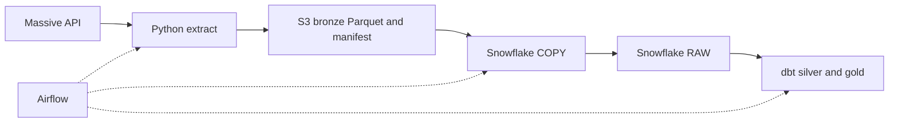

# US Equity Daily Bars

Daily US equity bars, archived and loaded into a medallion-style warehouse. One grouped request to the Massive API (formerly Polygon) returns every US listed stock for a session. Python writes that payload to S3 as Parquet plus a manifest. Snowflake RAW is the loaded copy. dbt under `transform/` is scaffolding for silver and gold; Airflow is planned to run the path the next morning.

The landing is the record of what the vendor returned. A later model can be rebuilt from it. A closed session is a zero-row file, which is a different fact from a date the job never ran.

The grain is one row per ticker per trade date, unadjusted. OTC names are excluded.

## Architecture



Airflow orders extract, load, and dbt. Each of those steps also runs on its own. Extract and the S3 landing are built. The COPY is built; a trading day and a closed day have been loaded on a live account. dbt project scaffold is in progress on `dbt-transform`. Airflow is planned.

| Step | Responsibility | State |
| --- | --- | --- |
| Extract | One Massive request and one Parquet partition per market date | Built |
| Bronze | S3 archive of the vendor payload, manifest written last | Built |
| Load | Date-scoped `COPY` into `MARKET.RAW`, plus an audit row | Built; trading and closed day verified |
| Transform | dbt builds `STAGING` (silver) and `MARTS` (gold) | In progress on `dbt-transform` (sources declared; models not written) |
| Orchestrate | Airflow runs extract, load, then `dbt build` | Planned |

S3 is the record of the vendor payload. `MARTS` will be the record of the analyst definition. The pipeline writes objects with its own AWS credentials. Snowflake reads them through a storage integration and an external stage, on a separate read-only role.

## Grain and landing

One row per ticker per trade date. Prices are unadjusted. The natural key is the ticker plus the trade date. `trade_date` is not a Parquet column. The partition path carries it, and the loader derives it in SQL from `t`.

```text
GET https://api.massive.com/v2/aggs/grouped/locale/us/market/stocks/{date}
```

Query parameters are `adjusted=false` and `include_otc=false`. The key is `Authorization: Bearer` from `MASSIVE_API_KEY`, with `Accept-Encoding: gzip`.

These nine columns are always present. Extra keys on a result are kept.

| Key | Meaning | Storage type |
| --- | --- | --- |
| `T` | Ticker | string |
| `o`, `h`, `l`, `c` | Open, high, low, close | float |
| `v` | Volume | float |
| `vw` | Volume-weighted average price | float |
| `t` | Bar timestamp, epoch milliseconds | int |
| `n` | Transaction count | int |

```text
bronze/daily_bars/trade_date=YYYY-MM-DD/bars.parquet
bronze/daily_bars/trade_date=YYYY-MM-DD/manifest.json
```

The prefix `bronze/daily_bars` is fixed. The manifest records `trade_date`, `row_count`, `extracted_at`, `request_id`, `api_status`, and `request_params` (`adjusted`, `include_otc`). A zero-row file uses the same columns.

A closed day lands that empty file and a manifest with `row_count` 0. An empty response on an XNYS session fails and uploads nothing. A failed request leaves the previous objects in place. The manifest is written after the Parquet file and is the commit marker.

`MARKET.RAW.DAILY_BARS` keeps the quoted vendor columns, plus nullable `trade_date` and `extracted_at`. Bar-row `extracted_at` is the Parquet object's S3 last-modified time. `MARKET.RAW.DAILY_BARS_LOADS` holds one row per loaded date, including closed days. Its `extracted_at` is the manifest clock.

Planned silver models cast types and send failing rows (null ticker, null close, high below low, negative volume) to quarantine. Planned gold is a star schema: `dim_date` from the loaded calendar range, `dim_ticker` as one row per symbol seen in the bars, and `fact_daily_bar` at the same grain as the landing. Close-to-close change on that fact is a price change. Splits and dividends are not in the extract. The dbt project overrides `generate_schema_name` so `STAGING` and `MARTS` are not concatenated onto the target schema. Staging and mart SQL models are not written yet.

## Stack

| Component | Why it is here |
| --- | --- |
| Python 3.14 | Runtime the extract and the loader are written against. |
| requests, urllib3 | One grouped GET, with retries on 429 and 5xx. |
| pyarrow | Parquet writer, including a typed zero-row file. |
| boto3 | S3 put for the landing, and the loader's read of it. |
| exchange_calendars | Local XNYS calendar, so an empty trading session fails. |
| python-dotenv | Loads `.env` for local runs. |
| Amazon S3 | Bronze archive of the vendor payload and the manifest. |
| Snowflake, snowflake-connector-python | Warehouse, key-pair auth, and the date-scoped `COPY`. |
| dbt-snowflake | Runtime pin for dbt Core against Snowflake. Project scaffold under `transform/`; models not built yet. |
| Apache Airflow | Planned schedule, retries, and backfill. Not installed. |
| pytest, responses, moto | Hermetic tests. No live HTTP, S3, or Snowflake. |
| Ruff | Lint and format. |

Runtime pins are in `requirements.txt`. pytest, responses, moto, and Ruff are the `dev` group in `pyproject.toml`.

## Design decisions

- **One grouped call.** The grouped daily endpoint returns the US stock session in one request. A per-ticker loop would spend the same payload on thousands of calls.
- **Unadjusted bars.** Massive applies split adjustment unless `adjusted=false`. A later split would rewrite values already archived. Adjustment waits for a splits extract.
- **Vendor columns, cleansing in SQL.** Python drops no rows and renames no fields. Quality rules in SQL can be tested, and the S3 object remains the payload the API sent.
- **Parquet.** Columnar files match the `COPY`, and a zero-row file can still carry the standard schema.
- **Manifest last.** The Parquet object is put at its final key, then `manifest.json`. Readers treat the manifest as the commit marker. A newer Parquet object means a re-extract is still in progress, and the loader refuses it.
- **Closed days and empty sessions.** A weekend or holiday still gets a file, so "market closed" is distinct from "never ran." Zero rows on an XNYS session mean the vendor has not published yet, so the run fails and leaves the previous object in place.
- **Idempotent dates.** Re-running a date overwrites that S3 partition. The loader deletes that `trade_date` and copies the file again in one transaction, so other dates stay. Delete-then-copy keeps one landing per date, so staging does not dedupe by `extracted_at`.
- **`FORCE = TRUE`.** Without it, `COPY` skips a file it has already loaded, and the delete would wipe the day.
- **`CASE_SENSITIVE`.** The file has both `T` and `t`. A case-insensitive match would collapse them. The RAW columns are quoted for the same reason.
- **`trade_date` in SQL.** `MATCH_BY_COLUMN_NAME` cannot take a `SELECT`, so the `COPY` inserts `trade_date` as null and the same transaction sets `TO_DATE(TO_TIMESTAMP_NTZ("t", 3))`. `t` marks the 16:00 New York close, so its UTC calendar date is always the session date and no timezone shift is needed. The column stays nullable because a `NOT NULL` constraint would reject the `COPY`.
- **Explicit `trade_date` parameter.** The DAG parameter defaults to the run's New York date minus one day. The same parameter is how a backfill or a manual run passes a date. `logical_date` follows the timetable, so it is the wrong clock for the market date.
- **06:00 next morning.** The DAG is planned for 06:00 America/New_York, Tuesday through Saturday (`0 6 * * 2-6`). Tuesday loads Monday. Saturday loads Friday. End-of-day aggregates have settled by then. The after-hours session closes at 20:00. A holiday lands an empty partition. Retries cover a trading day the vendor has not published yet.
- **Freshness on the audit table.** A closed day writes an audit row and no bar rows, so freshness on `DAILY_BARS` cannot see it. `transform/models/sources.yml` reads `DAILY_BARS_LOADS.extracted_at` and warns after about 3 days. A Monday holiday can still stretch the gap from Saturday 06:00 to Wednesday 06:00. That edge is accepted.
- **Hermetic tests.** Extract tests stub HTTP with `responses` and S3 with `moto`. Load tests mock the Snowflake connector the same way. A green test run does not call Massive, AWS, or Snowflake.

## Status

**Built.** The extract and RAW load are on `main`. `python -m extract.daily_bars YYYY-MM-DD` lands one market date on S3. `python -m load.copy_daily_bars YYYY-MM-DD` reloads that date into `MARKET.RAW`. A live trading day and a live closed day (`2026-10-25`) succeeded. Zero-row `COPY` returns one `LOADED` row with `rows_loaded` 0.

**In progress on `dbt-transform`.** `transform/` holds the dbt project scaffold (`dbt_project.yml`, env-only `profiles.yml`, `packages.yml`, `generate_schema_name` macro) and `models/sources.yml` (`raw.DAILY_BARS` plus freshness on `raw.DAILY_BARS_LOADS`). `dbt-snowflake` is pinned. Staging and mart SQL models are not written yet. Airflow is still planned.

**Planned.** Silver/gold models and tests under `transform/`; then the daily DAG and a sequential backfill. Airflow is planned as a local Docker run that calls the same extract and load functions. Before that image is built, its supported Python and constraints file have to be checked against this repo's 3.14 environment. The schedule and the `trade_date` parameter above are decided.

Reference data, splits, dividends, adjusted and total-return series, minute bars, trades, quotes, websockets, and hosted orchestration are later work. This repository is the daily path.

## Repository

```text
extract/daily_bars.py          grouped request, Parquet write, S3 put
extract/config.py              environment
load/copy_daily_bars.py        date-scoped Snowflake reload
snowflake/bootstrap.sql        RAW tables, integration, stage
transform/                     dbt project (sources.yml; staging/mart models not yet)
tests/test_daily_bars.py       hermetic extract tests
tests/test_copy_daily_bars.py  hermetic load tests
plans/00-roadmap.md            phase status and decision log
plans/01-extract.md            extract phase note
plans/02-raw-load.md           load phase note
plans/03-dbt-transform.md      current dbt step
plans/04-airflow.md            Airflow phase note
plans/improvements.md          open fixes
requirements.txt               runtime pins
pyproject.toml                 dev group, Ruff, pytest
.env.example                   variable names, no secrets
```

Not in the tree yet: `dags/`.

## Run locally

Requires Python 3.14, a Massive API key, and an S3 bucket the local AWS credentials can write. Create `.venv` when the checkout does not already have one, and use that interpreter for every command.

Windows:

```text
.venv\Scripts\python.exe -m pip install -r requirements.txt
.venv\Scripts\python.exe -m pip install --group dev
.venv\Scripts\python.exe -m extract.daily_bars 2024-03-15
```

macOS or Linux:

```text
.venv/bin/python -m pip install -r requirements.txt
.venv/bin/python -m pip install --group dev
.venv/bin/python -m extract.daily_bars 2024-03-15
```

Copy `.env.example` to `.env`. Set `MASSIVE_API_KEY` and `S3_BUCKET`. Set `AWS_DEFAULT_REGION` when you need to pin a region. A blank `AWS_DEFAULT_REGION` is dropped so boto3 uses its default region chain. S3 credentials come from the standard boto3 chain: environment variables first, then `~/.aws/credentials` if that file exists. This project loads `.env` into the process at startup, so keys in private `.env` work when there is no shared credentials file. `.env.example` does not list access keys.

A regular session lands thousands of symbols. A Saturday lands zero rows and a manifest with `row_count` 0.

The loader entry point is `python -m load.copy_daily_bars YYYY-MM-DD`. It also needs `SNOWFLAKE_ACCOUNT`, `SNOWFLAKE_USER`, `SNOWFLAKE_PRIVATE_KEY_PATH`, `SNOWFLAKE_WAREHOUSE`, and `SNOWFLAKE_ROLE`. `SNOWFLAKE_PRIVATE_KEY_PASSPHRASE` is only for an encrypted key. A trading day and a closed day have been loaded on a live account. The same Snowflake names feed `transform/profiles.yml`. From `transform/`, run `dbt deps --profiles-dir .`; later `dbt build --profiles-dir .` once models exist.

From the repository root, with the venv Python:

```text
python -m ruff check
python -m ruff format --check
python -m pytest
```

## Roadmap

Phase status, the current step, and the decision log are in [plans/00-roadmap.md](plans/00-roadmap.md).
